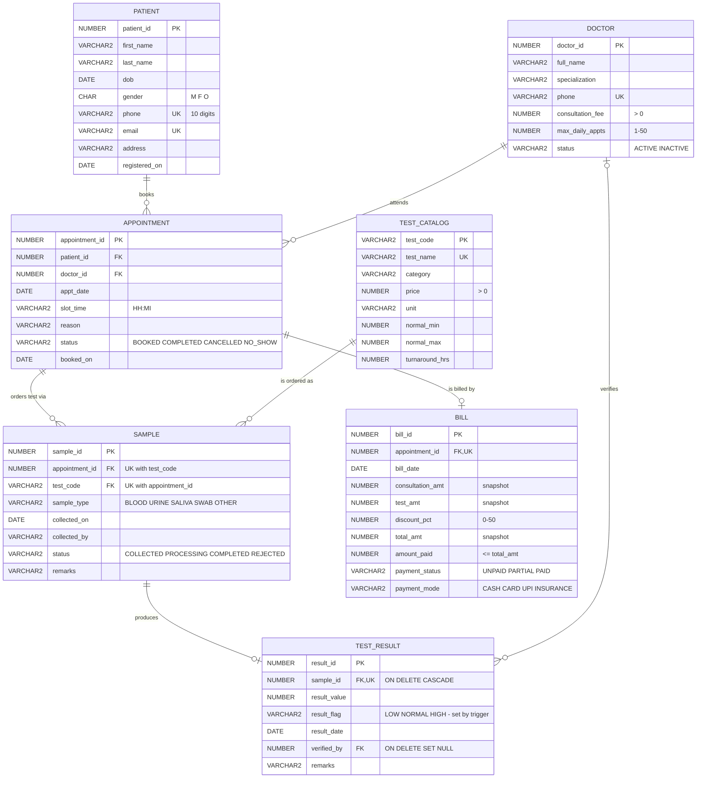

# MediTrack — Diagnostic Clinic Management System

**BCSE302L Database Systems** course project (VIT). It is an Oracle database for a single diagnostic clinic:
patients book doctor appointments, doctors order lab tests, technicians record samples and results,
and billing staff raise bills and record payments.

The business rules live **in the database** (constraints, triggers, stored procedures). They don't live in the UI.
If someone bypasses the app and types SQL directly, double booking, overpayment and wrong result flags are still impossible.

| | |
|---|---|
| Tables | 7 (PATIENT, DOCTOR, TEST_CATALOG, APPOINTMENT, SAMPLE, TEST_RESULT, BILL) |
| Keys | 7 primary keys, 7 foreign keys |
| Normal form | BCNF, plus one documented, deliberate snapshot in BILL |
| PL/SQL | 4 procedures (1 with an explicit cursor), 2 functions, 3 triggers, 1 view |
| Queries | 15, each mapped to a functional requirement |
| Front ends | menu-driven CLI (`app/main.py`) and a Streamlit clinic site with Patient, Doctor and Administration portals (`app/streamlit_app.py`) |

---

## Quick start

```bash
# 1. Python environment
python3 -m venv .venv && source .venv/bin/activate
pip install -r requirements.txt

# 2. Credentials (never hard-coded)
cp app/.env.example app/.env        # then edit ORACLE_USER / ORACLE_PASSWORD / ORACLE_DSN

# 3. Build the database (drop -> DDL -> functions -> procedures -> triggers -> seed -> queries)
python app/setup_db.py --quiet      # or, in SQL*Plus:  cd sql && sqlplus user/pw@dsn @00_build_all.sql
python app/setup_db.py --demo       # also runs 07_dml_demo.sql (T1-T7 walk-through) and prints every result

# 4. Run a front end
streamlit run app/streamlit_app.py  # browser UI (run from the project root so .streamlit/config.toml is used)
python app/main.py                  # terminal menu
```

No Oracle installed? Run Oracle Free in Docker. It needs about 4 GB of free disk:

```bash
docker run -d --name meditrack-oracle -p 1521:1521 \
  -e ORACLE_PASSWORD=oracle -e APP_USER=meditrack -e APP_USER_PASSWORD=meditrack \
  gvenzl/oracle-free:23-slim-faststart
# app/.env ->  ORACLE_USER=meditrack  ORACLE_PASSWORD=meditrack  ORACLE_DSN=localhost:1521/FREEPDB1
```

**Run order matters.** Triggers are created *before* the seed data, so every seed row passes through them.
The LOW/NORMAL/HIGH flags, sample COMPLETED statuses and bill payment statuses in the seed are all set by
triggers. None of them is typed by hand. The order is `99 → 01 → 04 → 05 → 06 → 02 → 03`, then `07` for the demo.

---

## Repository layout

```
sql/
  00_build_all.sql      SQL*Plus master script (runs the files below in the right order)
  01_ddl.sql            7 tables, every constraint named, 6 sequences
  02_seed_data.sql      12 patients, 10 doctors, 12 tests, 24 appointments, 18 samples, 16 results, 11 bills
  03_queries.sql        15 queries + view v_bill_summary (headers are parsed by the app's Reports page)
  04_functions.sql      doctor_daily_load, patient_total_due
  05_procedures.sql     book_appointment, generate_bill, record_payment, end_of_day_billing (cursor)
  06_triggers.sql       trg_no_double_booking, trg_flag_result, trg_payment_status
  07_dml_demo.sql       INSERT / UPDATE / DELETE walk-through of T1-T7, including failure cases
  99_drop_all.sql       drops everything (safe on an empty schema)
app/
  db.py                 connection from env vars, ORA-error -> clean message, SQL*Plus script runner
  services.py           one function per transaction T1-T7 (shared by both front ends)
  explain.py            turns an ORA code into a plain-language reason: why, which rule, what to do
  main.py               CLI menu
  streamlit_app.py      Streamlit site: home page + navigation over the three portals
  pages_patient.py      Patient portal: my health, book, visits, lab reports, bills, register
  pages_doctor.py       Doctor portal: my day, order tests, complete visit, patient results
  pages_admin.py        Administration: dashboard, lab desk, billing, reports, database, activity log
  ui.py                 theme CSS, cards, status pills, error panel, "behind the scenes" trace
  assets/               logo (SVG) and browser-tab icon
  setup_db.py           builds the database from sql/
  .env.example
.streamlit/config.toml  light-blue / white theme
```

### Front end: who does what

| Portal | Pages | Transactions |
|---|---|---|
| Patient | My health, Book a visit, My visits, Lab reports, Bills, New patient | T1 register + book, T5 pay, T7a cancel |
| Doctor | My day, Order tests, Complete visit, Patient results | T2a order tests, T4 complete + bill |
| Administration | Dashboard, Lab desk, Billing, Reports, Database, Activity log | T2b sample status, T3 result, T5, T6 end of day, T7b delete rejected sample |

The patient and doctor portals have a "Signed in as" picker. It is for the demo only: there is no login.
After every transaction the page shows a plain-language outcome and a "Behind the scenes" strip:
user operation → SQL/PL-SQL run → tables touched → rows affected. When the database refuses something,
the error panel gives the ORA code, the reason the rule exists, the trigger / procedure / constraint
that enforced it, and what to do next (`app/explain.py`; the CLI prints the same explanation).
The app takes "today" from the database (`TRUNC(SYSDATE)`), so screens and procedures agree even when
the database runs in another time zone (the Docker image uses UTC).

---

## ER diagram



**Reading the diagram**
- SAMPLE is an **associative entity**. It resolves the M:N between APPOINTMENT and TEST_CATALOG. A visit orders many tests,
  and a test is ordered in many visits. It has its own attributes (type, collected_on, status), so it is an entity, not a bare junction table.
- `TEST_RESULT.sample_id` and `BILL.appointment_id` are FKs **with UNIQUE**. That turns 1:N into 1:0..1:
  at most one result per sample and one bill per visit.
- `verified_by` is the only optional FK. A result can exist before a doctor verifies it.

---

## Relational schema

Constraint names follow `pk_<table>`, `fk_<table>_<col>`, `uq_<table>_<col>`, `ck_<table>_<col>`, `nn_<table>_<col>`.

### PATIENT
| Column | Type | Constraints |
|---|---|---|
| patient_id | NUMBER(6) | **PK** `pk_patient` · from `seq_patient` (starts 100001) |
| first_name | VARCHAR2(30) | NOT NULL |
| last_name | VARCHAR2(30) | NOT NULL |
| dob | DATE | NOT NULL (date-in-past check in the app, since CHECK can't use SYSDATE) |
| gender | CHAR(1) | NOT NULL · `ck_patient_gender` IN ('M','F','O') |
| phone | VARCHAR2(10) | NOT NULL · `uq_patient_phone` · `ck_patient_phone` 10 digits |
| email | VARCHAR2(60) | `uq_patient_email` (nullable) |
| address | VARCHAR2(150) | |
| registered_on | DATE | NOT NULL · DEFAULT SYSDATE |

### DOCTOR
| Column | Type | Constraints |
|---|---|---|
| doctor_id | NUMBER(4) | **PK** `pk_doctor` · `seq_doctor` (starts 1001) |
| full_name | VARCHAR2(60) | NOT NULL |
| specialization | VARCHAR2(40) | NOT NULL |
| phone | VARCHAR2(10) | `uq_doctor_phone` · `ck_doctor_phone` 10 digits |
| consultation_fee | NUMBER(8,2) | NOT NULL · `ck_doctor_consultation_fee` > 0 |
| max_daily_appts | NUMBER(2) | NOT NULL · DEFAULT 20 · `ck_doctor_max_daily_appts` 1–50 |
| status | VARCHAR2(8) | NOT NULL · DEFAULT 'ACTIVE' · `ck_doctor_status` IN ('ACTIVE','INACTIVE') |

### TEST_CATALOG
| Column | Type | Constraints |
|---|---|---|
| test_code | VARCHAR2(10) | **PK** `pk_test_catalog` (natural key, e.g. `FBS`) |
| test_name | VARCHAR2(60) | NOT NULL · `uq_test_catalog_test_name` |
| category | VARCHAR2(30) | NOT NULL |
| price | NUMBER(8,2) | NOT NULL · `ck_test_catalog_price` > 0 |
| unit | VARCHAR2(15) | NOT NULL |
| normal_min, normal_max | NUMBER(10,2) | NOT NULL · `ck_test_catalog_range` normal_min <= normal_max |
| turnaround_hrs | NUMBER(3) | NOT NULL · DEFAULT 24 · > 0 |

### APPOINTMENT
| Column | Type | Constraints |
|---|---|---|
| appointment_id | NUMBER(8) | **PK** · `seq_appointment` (starts 500001) |
| patient_id | NUMBER(6) | NOT NULL · **FK** `fk_appointment_patient_id` → PATIENT |
| doctor_id | NUMBER(4) | NOT NULL · **FK** `fk_appointment_doctor_id` → DOCTOR |
| appt_date | DATE | NOT NULL · `ck_appointment_appt_date` = TRUNC(appt_date) (day only) |
| slot_time | VARCHAR2(5) | NOT NULL · `ck_appointment_slot_time` REGEXP_LIKE 'HH:MI' (24 h) |
| reason | VARCHAR2(200) | |
| status | VARCHAR2(10) | NOT NULL · DEFAULT 'BOOKED' · IN ('BOOKED','COMPLETED','CANCELLED','NO_SHOW') |
| booked_on | DATE | NOT NULL · DEFAULT SYSDATE |

Double booking is blocked by **trigger** `trg_no_double_booking`, not by a UNIQUE constraint. That way a CANCELLED slot can be booked again.

### SAMPLE
| Column | Type | Constraints |
|---|---|---|
| sample_id | NUMBER(8) | **PK** · `seq_sample` (starts 700001) |
| appointment_id | NUMBER(8) | NOT NULL · **FK** `fk_sample_appointment_id` → APPOINTMENT |
| test_code | VARCHAR2(10) | NOT NULL · **FK** `fk_sample_test_code` → TEST_CATALOG |
| sample_type | VARCHAR2(6) | NOT NULL · IN ('BLOOD','URINE','SALIVA','SWAB','OTHER') |
| collected_on | DATE | NOT NULL · DEFAULT SYSDATE |
| collected_by | VARCHAR2(40) | |
| status | VARCHAR2(10) | NOT NULL · DEFAULT 'COLLECTED' · IN ('COLLECTED','PROCESSING','COMPLETED','REJECTED') |
| remarks | VARCHAR2(100) | |
| | | `uq_sample_appt_test` UNIQUE (appointment_id, test_code) |

### TEST_RESULT
| Column | Type | Constraints |
|---|---|---|
| result_id | NUMBER(8) | **PK** · `seq_test_result` (starts 800001) |
| sample_id | NUMBER(8) | NOT NULL · `uq_test_result_sample_id` · **FK** → SAMPLE **ON DELETE CASCADE** |
| result_value | NUMBER(10,2) | NOT NULL |
| result_flag | VARCHAR2(6) | NOT NULL · DEFAULT 'NORMAL' · IN ('LOW','NORMAL','HIGH'), **set by `trg_flag_result`** |
| result_date | DATE | NOT NULL · DEFAULT SYSDATE |
| verified_by | NUMBER(4) | **FK** → DOCTOR **ON DELETE SET NULL** |
| remarks | VARCHAR2(200) | |

### BILL
| Column | Type | Constraints |
|---|---|---|
| bill_id | NUMBER(8) | **PK** · `seq_bill` (starts 900001) |
| appointment_id | NUMBER(8) | NOT NULL · `uq_bill_appointment_id` · **FK** → APPOINTMENT |
| bill_date | DATE | NOT NULL · DEFAULT SYSDATE |
| consultation_amt | NUMBER(10,2) | NOT NULL · >= 0 (snapshot of the doctor's fee) |
| test_amt | NUMBER(10,2) | NOT NULL · DEFAULT 0 · >= 0 (snapshot of the test prices) |
| discount_pct | NUMBER(5,2) | NOT NULL · DEFAULT 0 · `ck_bill_discount_pct` 0–50 |
| total_amt | NUMBER(10,2) | NOT NULL · `ck_bill_total_amt` = ROUND((consultation_amt + test_amt) × (1 − discount_pct/100), 2) |
| amount_paid | NUMBER(10,2) | NOT NULL · DEFAULT 0 · `ck_bill_paid_le_total` amount_paid <= total_amt |
| payment_status | VARCHAR2(7) | NOT NULL · DEFAULT 'UNPAID' · IN ('UNPAID','PARTIAL','PAID'), **set by `trg_payment_status`** |
| payment_mode | VARCHAR2(10) | IN ('CASH','CARD','UPI','INSURANCE') |

---

## Normalization summary

| Table | Key | Non-trivial FDs | Highest NF |
|---|---|---|---|
| PATIENT | patient_id (candidates: phone, email) | patient_id → all; phone → patient_id | BCNF |
| DOCTOR | doctor_id (candidate: phone) | doctor_id → all | BCNF |
| TEST_CATALOG | test_code (candidate: test_name) | test_code → all | BCNF |
| APPOINTMENT | appointment_id | appointment_id → all | BCNF |
| SAMPLE | sample_id (candidate: appointment_id + test_code) | both keys → all | BCNF |
| TEST_RESULT | result_id (candidate: sample_id) | both keys → all | BCNF |
| BILL | bill_id (candidate: appointment_id) | keys → all; (consultation_amt, test_amt, discount_pct) → total_amt | 3NF in spirit, deliberate snapshot (see below) |

- **1NF:** every column is atomic. One phone, one slot, one result value. Multiple tests per visit are rows in SAMPLE,
  not a comma-separated column.
- **2NF:** every table with a composite candidate key (SAMPLE) has no attribute that depends on only part of it.
  `test_name` and `price` depend on `test_code` alone, so they live in TEST_CATALOG and not in SAMPLE.
- **3NF / BCNF:** no non-key attribute determines another. The doctor's fee is not copied into APPOINTMENT.
  The patient's name is not copied into BILL. Every determinant is a candidate key.
- **Deliberate snapshot in BILL:** `consultation_amt`, `test_amt` and `total_amt` *could* be recomputed from DOCTOR,
  SAMPLE and TEST_CATALOG. They are stored on purpose. A bill is a legal record of what was charged *on that day*.
  If the fee or a test price changes next month, old bills must not change. The redundancy inside the row
  (total derived from its parts) is guarded by `ck_bill_total_amt`, so it can never be inconsistent.

Full talking points (FDs per table, anomalies avoided, likely viva questions) are in the Claude Doc
**"MediTrack — Viva Talking Points"**.

---

## Functional requirements

> These must match the Review I report. If the report numbers them differently, update the `FR` lines in
> `sql/03_queries.sql` and this table together.

| # | Requirement | Where |
|---|---|---|
| FR1 | Register patients with unique phone/email | T1, `uq_patient_phone` |
| FR2 | Maintain doctors; deactivate instead of delete | DOCTOR.status, `-20001` |
| FR3 | Book appointments and view each doctor's daily schedule | T1, Q1, Q9 |
| FR4 | Prevent double booking and enforce each doctor's daily capacity | `trg_no_double_booking`, `doctor_daily_load` |
| FR5 | Maintain a test catalogue with prices and normal ranges | TEST_CATALOG, Q7 |
| FR6 | Order tests per visit and track sample collection | T2, SAMPLE |
| FR7 | Record results with automatic LOW / NORMAL / HIGH flagging | T3, `trg_flag_result`, Q3, Q11, Q13 |
| FR8 | Track pending samples against turnaround time | Q2 |
| FR9 | Generate a bill for each completed visit | T4, `generate_bill`, Q10, Q15 |
| FR10 | Record full or partial payments and report patient dues | T5, `record_payment`, `patient_total_due`, Q6 |
| FR11 | Bill all of a day's completed visits in one batch | T6, `end_of_day_billing` |
| FR12 | Management reports on revenue, workload and test usage | Q4, Q5, Q8, Q12, Q14 |

---

## PL/SQL components and error codes

| Component | Name | Transaction |
|---|---|---|
| Function | `doctor_daily_load(p_doctor_id, p_date)` | T1 |
| Function | `patient_total_due(p_patient_id)` | T5 |
| Procedure | `book_appointment(...)` | T1 |
| Procedure | `generate_bill(p_appointment_id, p_discount_pct DEFAULT 0)` | T4, T6 |
| Procedure | `record_payment(p_bill_id, p_amount, p_mode)` | T5 |
| Procedure + cursor | `end_of_day_billing(p_date)` with explicit cursor `c_unbilled` | T6 |
| Trigger | `trg_no_double_booking` BEFORE INSERT ON appointment | T1 |
| Trigger | `trg_flag_result` BEFORE INSERT OR UPDATE OF result_value ON test_result | T3 |
| Trigger | `trg_payment_status` BEFORE UPDATE OF amount_paid ON bill | T5 |
| View | `v_bill_summary` | T5, Q15 |

| Code | Rule | Raised by |
|---|---|---|
| -20001 | Doctor is INACTIVE | book_appointment |
| -20002 | Doctor's day is full | book_appointment |
| -20003 | Doctor or patient already booked in that slot | trg_no_double_booking |
| -20004 | Appointment date in the past | book_appointment |
| -20005 | Doctor does not exist | book_appointment |
| -20010 | Visit is not COMPLETED | generate_bill |
| -20011 | Visit already billed | generate_bill |
| -20012 | Appointment does not exist | generate_bill |
| -20020 | Payment <= 0 or more than the balance | record_payment |
| -20021 | Bill does not exist | record_payment |
| -20030 | Result for a REJECTED sample | trg_flag_result |
| -20031 | Sample does not exist | trg_flag_result |

**Transaction control:** `book_appointment`, `generate_bill` and `record_payment` do **not** commit. The caller
commits once per unit of work. For example, T4 marks the visit COMPLETED and raises the bill in one commit.
`end_of_day_billing` is a batch job. It commits once after the cursor loop and rolls back everything if any visit fails.

---

## Transactions (Review III)

| # | Operation | Components exercised |
|---|---|---|
| T1 | Register patient + book appointment | INSERT PATIENT, `book_appointment`, `doctor_daily_load`, `trg_no_double_booking` |
| T2 | Order tests, collect samples | INSERT SAMPLE, UPDATE SAMPLE status |
| T3 | Enter test result | INSERT TEST_RESULT, `trg_flag_result` |
| T4 | Complete visit + bill | UPDATE APPOINTMENT, `generate_bill` |
| T5 | Payment + dues check | `record_payment`, `trg_payment_status`, `patient_total_due` |
| T6 | End-of-day billing | `end_of_day_billing` (cursor) |
| T7 | Cancel visit, delete rejected sample | UPDATE APPOINTMENT, DELETE SAMPLE (cascades to TEST_RESULT) |

Both front ends print the full trace after each one: **operation → tables touched → SQL/PL-SQL run → rows affected → result**.

### Seeded demo cases
- Dr. Ramesh Patel (1010) is INACTIVE, so booking him gives -20001.
- Dr. Sanjay Gupta (1009) allows 2 appointments a day and already has 2 today, so booking him today gives -20002.
- Dr. Rajesh Kumar today at 10:00 is taken, so booking it gives -20003. Dr. Nair today at 09:00 was cancelled and then rebooked.
- Sample 700013 (platelets) was resulted and then REJECTED. T7 deletes it and the result cascades.
- Visits 500013 and 500014 are COMPLETED but not billed. T6 picks them up.
- Test B12 has never been ordered (Q7). Bills cover UNPAID, PARTIAL and PAID.
- Dates are relative to `SYSDATE`, so "today's schedule" always has data on demo day.
